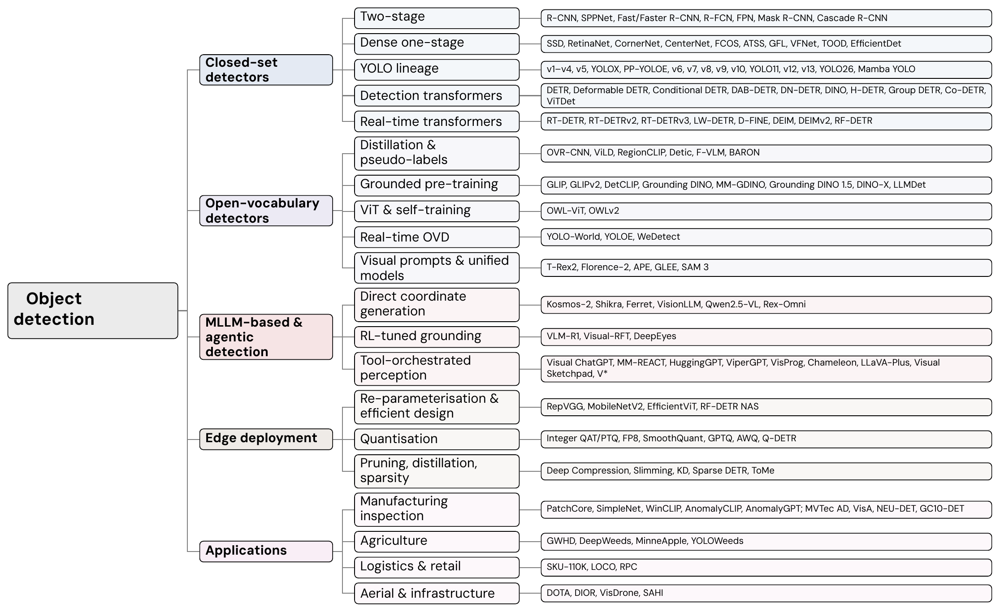
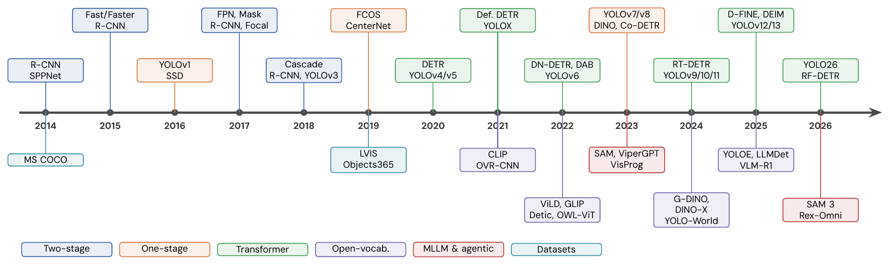
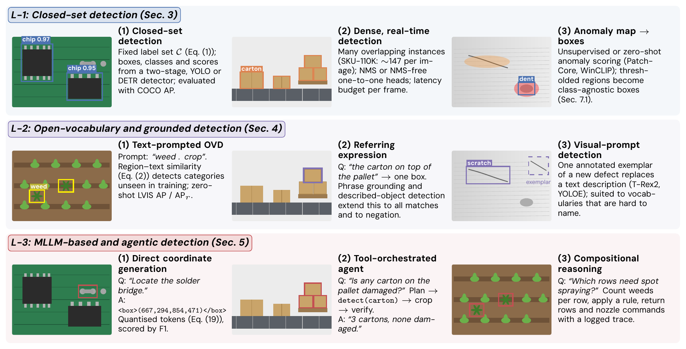
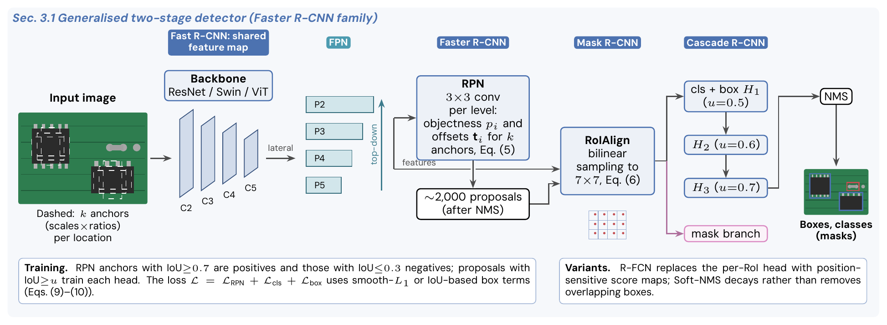
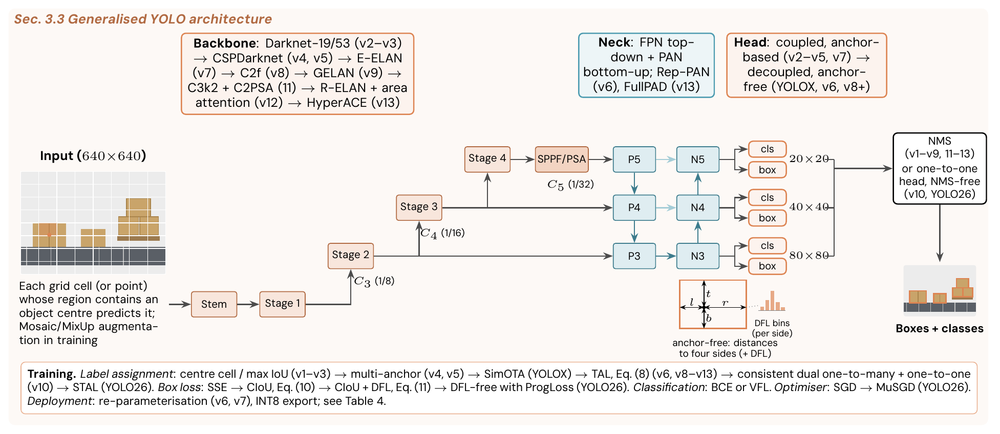
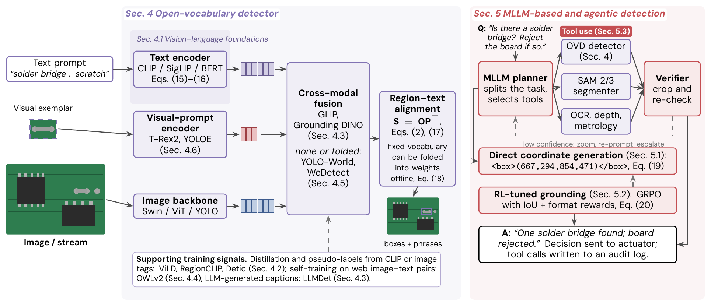
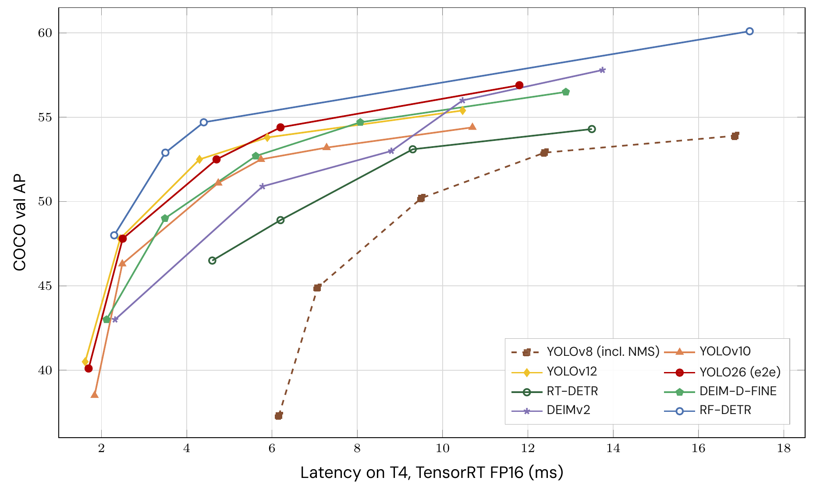

# Awesome Agentic Object Detection [](https://awesome.re)

  

A curated, continuously updated list of papers, datasets and benchmarks on **object detection from two-stage CNNs and YOLO to real-time detection transformers, open-vocabulary detectors and MLLM-based agents**, with a focus on **edge deployment** and **industrial, agricultural and logistics applications**.

This repository accompanies the survey:

> **From YOLO and Faster R-CNN to Open-Vocabulary Agents: A Survey of Object Detection and Applications**
> AUTHORS. *Academia AI and Applications*, 2026 (under review).
> [Paper](LINK_TO_PAPER) · [Supplementary S1](LINK_TO_SUPPLEMENT)

## 📌 Citation

If you find this survey or repository useful, please cite:

```bibtex
@article{AUTHORKEY2026detectionsurvey,
  title   = {From YOLO and Faster R-CNN to Open-Vocabulary Agents: A Survey of Object Detection and Applications},
  author  = {Binay Kumar Singh},
  journal = {Academia AI and Applications},
  year    = {2026},
  note    = {Under review}
}
```

## 🔥 News

- **2026-10**: Survey submitted to *Academia AI and Applications*; repository released with 215 papers, 11 benchmark tables and 8 figures.

## 🗺️ Overview



*Taxonomy of the methods covered in the survey.*





*Three levels of detection tasks: closed-set, open-vocabulary/grounded, and MLLM-based/agentic.*

### Generalised architectures



*Generalised two-stage detector (Faster R-CNN family).*



*Generalised YOLO architecture across v1–YOLO26.*



*From open-vocabulary detectors to agents.*

## 📊 Benchmarks at a glance



*COCO accuracy versus T4 latency of real-time detectors, as reported by the original authors.* All benchmark tables of the survey are available as CSV files in [`tables/`](tables/) (see [`tables/README.md`](tables/README.md) for protocols).

| Table | File |
|---|---|
| Real-time YOLO detectors on COCO | [`coco_realtime_yolo.csv`](tables/coco_realtime_yolo.csv) |
| Real-time detection transformers on COCO | [`coco_realtime_detr.csv`](tables/coco_realtime_detr.csv) |
| Zero-shot open-vocabulary detection on LVIS / COCO | [`lvis_zeroshot_ovd.csv`](tables/lvis_zeroshot_ovd.csv) |
| MLLM detectors (F1) | [`mllm_f1.csv`](tables/mllm_f1.csv) |
| Industrial anomaly detection (AUROC) | [`anomaly_auroc.csv`](tables/anomaly_auroc.csv) |
| YOLO genealogy | [`yolo_genealogy.csv`](tables/yolo_genealogy.csv) |
| Edge hardware | [`edge_hardware.csv`](tables/edge_hardware.csv) |
| Datasets | [`datasets_general.csv`](tables/datasets_general.csv), [`datasets_applications.csv`](tables/datasets_applications.csv) |

## 📑 Contents

- [Related surveys](#related-surveys)
- [Datasets and evaluation metrics](#datasets-and-evaluation-metrics) (Sec. 2)
- [Two-stage detectors](#two-stage-detectors) (Sec. 3.1)
- [Dense single-stage detectors, label assignment and losses](#dense-single-stage-detectors-label-assignment-and-losses) (Sec. 3.2)
- [YOLO family](#yolo-family) (Sec. 3.3)
- [Detection transformers](#detection-transformers) (Sec. 3.4)
- [Real-time detection transformers](#real-time-detection-transformers) (Sec. 3.5)
- [Backbones and foundation models](#backbones-and-foundation-models) (Sec. 3)
- [Open-vocabulary detection](#open-vocabulary-detection) (Sec. 4)
- [MLLM grounding and RL-tuned detection](#mllm-grounding-and-rl-tuned-detection) (Sec. 5.1–5.2)
- [Agentic and tool-orchestrated perception](#agentic-and-tool-orchestrated-perception) (Sec. 5.3)
- [Edge deployment and model compression](#edge-deployment-and-model-compression) (Sec. 6)
- [Manufacturing: datasets](#manufacturing-datasets) (Sec. 7.1)
- [Manufacturing: anomaly detection](#manufacturing-anomaly-detection) (Sec. 7.1)
- [Agriculture](#agriculture) (Sec. 7.2)
- [Logistics and retail](#logistics-and-retail) (Sec. 7.3)
- [Aerial and infrastructure inspection](#aerial-and-infrastructure-inspection) (Sec. 7.4)
- [Robustness, safety and regulation](#robustness-safety-and-regulation) (Sec. 8)

Section numbers (Sec. ) refer to the survey. Within each list, papers are sorted newest first. "search" links open a Google Scholar search for the title.

## Related surveys
| Year | Title | Authors | Venue | Link |
|---|---|---|---|---|
| 2026 | Toward Visual Grounding: A Survey | Xiao et al. | TPAMI | [DOI](https://doi.org/10.1109/TPAMI.2025.3630635) |
| 2025 | A Survey on Agentic Multimodal Large Language Models | Yao et al. | arXiv | [arXiv](https://arxiv.org/abs/2510.10991) |
| 2025 | Open-Vocabulary Object Detection in UAV Imagery: A Review and Future Perspectives | Zhou et al. | Drones | [paper](https://doi.org/10.3390/drones9080557) |
| 2025 | YOLO Advances to Its Genesis: A Decadal and Comprehensive Review of the You Only Look Once (YOLO) Series | Sapkota et al. | Artif Intell Rev | [paper](https://doi.org/10.1007/s10462-025-11253-3) |
| 2024 | A Survey on Open-Vocabulary Detection and Segmentation: Past, Present, and Future | Zhu et al. | IEEE Trans Pattern Anal Mach Intell | [paper](https://doi.org/10.1109/TPAMI.2024.3413013) |
| 2024 | Agricultural Object Detection with You Only Look Once (YOLO) Algorithm: A Bibliometric and Systematic Literature Review | Badgujar et al. | Comput Electron Agric | [paper](https://doi.org/10.1016/j.compag.2024.109090) |
| 2024 | Deep Industrial Image Anomaly Detection: A Survey | Liu et al. | Mach Intell Res | [paper](https://doi.org/10.1007/s11633-023-1459-z) |
| 2024 | Towards Open Vocabulary Learning: A Survey | Wu et al. | IEEE Trans Pattern Anal Mach Intell | [paper](https://doi.org/10.1109/TPAMI.2024.3361862) |
| 2023 | A Comprehensive Review of YOLO Architectures in Computer Vision: From YOLOv1 to YOLOv8 and YOLO-NAS | Terven et al. | Mach Learn Knowl Extr | [paper](https://doi.org/10.3390/make5040083) |
| 2023 | Object Detection in 20 Years: A Survey | Zou et al. | Proc IEEE | [paper](https://doi.org/10.1109/JPROC.2023.3238524) |
| 2023 | Object Detection with Transformers: A Review | Shehzadi et al. | arXiv | [arXiv](https://arxiv.org/abs/2306.04670) |
| 2020 | Deep Learning for Generic Object Detection: A Survey | Liu et al. | Int J Comput Vis | [paper](https://doi.org/10.1007/s11263-019-01247-4) |
| 2019 | Object Detection With Deep Learning: A Review | Zhao et al. | IEEE Trans Neural Netw Learn Syst | [paper](https://doi.org/10.1109/TNNLS.2018.2876865) |

## Datasets and evaluation metrics
*Survey Sec. 2*

| Year | Title | Authors | Venue | Link |
|---|---|---|---|---|
| 2025 | Roboflow100-VL: A Multi-Domain Object Detection Benchmark for Vision-Language Models | Robicheaux et al. | NeurIPS D&B | [search](https://scholar.google.com/scholar?q=Roboflow100-VL%3A+A+Multi-Domain+Object+Detection+Benchmark+for+Vision-Language+Models) |
| 2022 | Roboflow 100: A Rich, Multi-Domain Object Detection Benchmark | Ciaglia et al. | arXiv | [arXiv](https://arxiv.org/abs/2211.13523) |
| 2021 | Evaluating Large-Vocabulary Object Detectors: The Devil is in the Details | Dave et al. | arXiv | [arXiv](https://arxiv.org/abs/2102.01066) |
| 2020 | A Survey on Performance Metrics for Object-Detection Algorithms | Padilla et al. | IWSSIP | [DOI](https://doi.org/10.1109/IWSSIP48289.2020.9145130) |
| 2020 | TIDE: A General Toolbox for Identifying Object Detection Errors | Bolya et al. | ECCV | [DOI](https://doi.org/10.1007/978-3-030-58580-8_33) |
| 2020 | The Open Images Dataset V4: Unified Image Classification, Object Detection, and Visual Relationship Detection at Scale | Kuznetsova et al. | Int J Comput Vis | [DOI](https://doi.org/10.1007/s11263-020-01316-z) |
| 2019 | LVIS: A Dataset for Large Vocabulary Instance Segmentation | Gupta et al. | CVPR | [DOI](https://doi.org/10.1109/CVPR.2019.00550) |
| 2019 | Objects365: A Large-Scale, High-Quality Dataset for Object Detection | Shao et al. | ICCV | [DOI](https://doi.org/10.1109/ICCV.2019.00852) |
| 2016 | Generation and Comprehension of Unambiguous Object Descriptions | Mao et al. | CVPR | [DOI](https://doi.org/10.1109/CVPR.2016.9) |
| 2016 | Modeling Context in Referring Expressions | Yu et al. | ECCV | [DOI](https://doi.org/10.1007/978-3-319-46475-6_5) |
| 2015 | Flickr30k Entities: Collecting Region-to-Phrase Correspondences for Richer Image-to-Sentence Models | Plummer et al. | ICCV | [DOI](https://doi.org/10.1109/ICCV.2015.303) |
| 2014 | Microsoft COCO: Common Objects in Context | Lin et al. | ECCV | [DOI](https://doi.org/10.1007/978-3-319-10602-1_48) |
| 2010 | The PASCAL Visual Object Classes (VOC) Challenge | Everingham et al. | Int J Comput Vis | [DOI](https://doi.org/10.1007/s11263-009-0275-4) |
| 2009 | ImageNet: A Large-Scale Hierarchical Image Database | Deng et al. | CVPR | [DOI](https://doi.org/10.1109/CVPR.2009.5206848) |

## Two-stage detectors
*Survey Sec. 3.1*

| Year | Title | Authors | Venue | Link |
|---|---|---|---|---|
| 2026 | Contextually Enhanced Unknown Aware Contrastive Learning based Co-occurring Object Detection | Singh et al. | IEEE Access | [DOI](https://doi.org/10.1109/ACCESS.2026.3718368) |
| 2024 | SDLNet: Statistical Deep Learning Network for Co-Occurring Object Detection and Identification | Singh et al. | ICMLT | [DOI](https://doi.org/10.1145/3674029.3674055) |
| 2018 | Cascade R-CNN: Delving into High Quality Object Detection | Cai et al. | CVPR | [DOI](https://doi.org/10.1109/CVPR.2018.00644) |
| 2017 | Feature Pyramid Networks for Object Detection | Lin et al. | CVPR | [DOI](https://doi.org/10.1109/CVPR.2017.106) |
| 2017 | Mask R-CNN | He et al. | ICCV | [DOI](https://doi.org/10.1109/ICCV.2017.322) |
| 2017 | Soft-NMS – Improving Object Detection with One Line of Code | Bodla et al. | ICCV | [DOI](https://doi.org/10.1109/ICCV.2017.593) |
| 2016 | R-FCN: Object Detection via Region-Based Fully Convolutional Networks | Dai et al. | NeurIPS | [search](https://scholar.google.com/scholar?q=R-FCN%3A+Object+Detection+via+Region-Based+Fully+Convolutional+Networks) |
| 2015 | Fast R-CNN | Girshick | ICCV | [DOI](https://doi.org/10.1109/ICCV.2015.169) |
| 2015 | Faster R-CNN: Towards Real-Time Object Detection with Region Proposal Networks | Ren et al. | NeurIPS | [search](https://scholar.google.com/scholar?q=Faster+R-CNN%3A+Towards+Real-Time+Object+Detection+with+Region+Proposal+Networks) |
| 2015 | Spatial Pyramid Pooling in Deep Convolutional Networks for Visual Recognition | He et al. | IEEE Trans Pattern Anal Mach Intell | [DOI](https://doi.org/10.1109/TPAMI.2015.2389824) |
| 2014 | Rich Feature Hierarchies for Accurate Object Detection and Semantic Segmentation | Girshick et al. | CVPR | [DOI](https://doi.org/10.1109/CVPR.2014.81) |
| 2006 | Efficient Non-Maximum Suppression | Neubeck et al. | ICPR | [DOI](https://doi.org/10.1109/ICPR.2006.479) |

## Dense single-stage detectors, label assignment and losses
*Survey Sec. 3.2*

| Year | Title | Authors | Venue | Link |
|---|---|---|---|---|
| 2022 | Focal and Efficient IOU Loss for Accurate Bounding Box Regression | Zhang et al. | Neurocomputing | [DOI](https://doi.org/10.1016/j.neucom.2022.07.042) |
| 2022 | SIoU Loss: More Powerful Learning for Bounding Box Regression | Gevorgyan | arXiv | [arXiv](https://arxiv.org/abs/2205.12740) |
| 2021 | OTA: Optimal Transport Assignment for Object Detection | Ge et al. | CVPR | [DOI](https://doi.org/10.1109/CVPR46437.2021.00037) |
| 2021 | TOOD: Task-Aligned One-Stage Object Detection | Feng et al. | ICCV | [DOI](https://doi.org/10.1109/ICCV48922.2021.00349) |
| 2021 | VarifocalNet: An IoU-Aware Dense Object Detector | Zhang et al. | CVPR | [DOI](https://doi.org/10.1109/CVPR46437.2021.00841) |
| 2020 | Bridging the Gap Between Anchor-Based and Anchor-Free Detection via Adaptive Training Sample Selection | Zhang et al. | CVPR | [DOI](https://doi.org/10.1109/CVPR42600.2020.00978) |
| 2020 | Distance-IoU Loss: Faster and Better Learning for Bounding Box Regression | Zheng et al. | AAAI | [DOI](https://doi.org/10.1609/aaai.v34i07.6999) |
| 2020 | EfficientDet: Scalable and Efficient Object Detection | Tan et al. | CVPR | [DOI](https://doi.org/10.1109/CVPR42600.2020.01079) |
| 2020 | Generalized Focal Loss: Learning Qualified and Distributed Bounding Boxes for Dense Object Detection | Li et al. | NeurIPS | [search](https://scholar.google.com/scholar?q=Generalized+Focal+Loss%3A+Learning+Qualified+and+Distributed+Bounding+Boxes+for+Dense+Object+Detection) |
| 2019 | FCOS: Fully Convolutional One-Stage Object Detection | Tian et al. | ICCV | [DOI](https://doi.org/10.1109/ICCV.2019.00972) |
| 2019 | Generalized Intersection over Union: A Metric and a Loss for Bounding Box Regression | Rezatofighi et al. | CVPR | [DOI](https://doi.org/10.1109/CVPR.2019.00075) |
| 2019 | Learning Spatial Fusion for Single-Shot Object Detection | Liu et al. | arXiv | [arXiv](https://arxiv.org/abs/1911.09516) |
| 2019 | Objects as Points | Zhou et al. | arXiv | [arXiv](https://arxiv.org/abs/1904.07850) |
| 2018 | CornerNet: Detecting Objects as Paired Keypoints | Law et al. | ECCV | [DOI](https://doi.org/10.1007/978-3-030-01264-9_45) |
| 2018 | Path Aggregation Network for Instance Segmentation | Liu et al. | CVPR | [DOI](https://doi.org/10.1109/CVPR.2018.00913) |
| 2017 | Focal Loss for Dense Object Detection | Lin et al. | ICCV | [DOI](https://doi.org/10.1109/ICCV.2017.324) |
| 2016 | SSD: Single Shot MultiBox Detector | Liu et al. | ECCV | [DOI](https://doi.org/10.1007/978-3-319-46448-0_2) |

## YOLO family
*Survey Sec. 3.3*

| Year | Title | Authors | Venue | Link |
|---|---|---|---|---|
| 2026 | Ultralytics YOLO26: Unified Real-Time End-to-End Vision Models | Jocher et al. | arXiv | [arXiv](https://arxiv.org/abs/2606.03748) |
| 2025 | Mamba YOLO: A Simple Baseline for Object Detection with State Space Model | Wang et al. | AAAI | [DOI](https://doi.org/10.1609/aaai.v39i8.32885) |
| 2025 | YOLOv12: Attention-Centric Real-Time Object Detectors | Tian et al. | NeurIPS | [DOI](https://doi.org/10.52202/085713-2627) |
| 2025 | YOLOv13: Real-Time Object Detection with Hypergraph-Enhanced Adaptive Visual Perception | Lei et al. | arXiv | [arXiv](https://arxiv.org/abs/2506.17733) |
| 2024 | Ultralytics YOLO11 | Jocher et al. | Software | [link](https://github.com/ultralytics/ultralytics) |
| 2024 | YOLOv10: Real-Time End-to-End Object Detection | Wang et al. | NeurIPS | [DOI](https://doi.org/10.52202/079017-3429) |
| 2024 | YOLOv9: Learning What You Want to Learn Using Programmable Gradient Information | Wang et al. | ECCV | [DOI](https://doi.org/10.1007/978-3-031-72751-1_1) |
| 2023 | Ultralytics YOLOv8 | Jocher et al. | Software | [link](https://github.com/ultralytics/ultralytics) |
| 2023 | YOLOv7: Trainable Bag-of-Freebies Sets New State-of-the-Art for Real-Time Object Detectors | Wang et al. | CVPR | [DOI](https://doi.org/10.1109/CVPR52729.2023.00721) |
| 2022 | PP-YOLOE: An Evolved Version of YOLO | Xu et al. | arXiv | [arXiv](https://arxiv.org/abs/2203.16250) |
| 2022 | YOLOv6: A Single-Stage Object Detection Framework for Industrial Applications | Li et al. | arXiv | [arXiv](https://arxiv.org/abs/2209.02976) |
| 2021 | RepVGG: Making VGG-Style ConvNets Great Again | Ding et al. | CVPR | [DOI](https://doi.org/10.1109/CVPR46437.2021.01352) |
| 2021 | YOLOX: Exceeding YOLO Series in 2021 | Ge et al. | arXiv | [arXiv](https://arxiv.org/abs/2107.08430) |
| 2020 | YOLOv5 by Ultralytics | Jocher | Software | [paper](https://doi.org/10.5281/zenodo.3908559) |
| 2020 | YOLOv4: Optimal Speed and Accuracy of Object Detection | Bochkovskiy et al. | arXiv | [arXiv](https://arxiv.org/abs/2004.10934) |
| 2018 | YOLOv3: An Incremental Improvement | Redmon et al. | arXiv | [arXiv](https://arxiv.org/abs/1804.02767) |
| 2017 | YOLO9000: Better, Faster, Stronger | Redmon et al. | CVPR | [DOI](https://doi.org/10.1109/CVPR.2017.690) |
| 2016 | You Only Look Once: Unified, Real-Time Object Detection | Redmon et al. | CVPR | [DOI](https://doi.org/10.1109/CVPR.2016.91) |

## Detection transformers
*Survey Sec. 3.4*

| Year | Title | Authors | Venue | Link |
|---|---|---|---|---|
| 2023 | DETRs with Collaborative Hybrid Assignments Training | Zong et al. | ICCV | [DOI](https://doi.org/10.1109/ICCV51070.2023.00621) |
| 2023 | DETRs with Hybrid Matching | Jia et al. | CVPR | [DOI](https://doi.org/10.1109/CVPR52729.2023.01887) |
| 2023 | DINO: DETR with Improved DeNoising Anchor Boxes for End-to-End Object Detection | Zhang et al. | ICLR | [search](https://scholar.google.com/scholar?q=DINO%3A+DETR+with+Improved+DeNoising+Anchor+Boxes+for+End-to-End+Object+Detection) |
| 2023 | Group DETR: Fast DETR Training with Group-Wise One-to-Many Assignment | Chen et al. | ICCV | [DOI](https://doi.org/10.1109/ICCV51070.2023.00610) |
| 2022 | DAB-DETR: Dynamic Anchor Boxes are Better Queries for DETR | Liu et al. | ICLR | [search](https://scholar.google.com/scholar?q=DAB-DETR%3A+Dynamic+Anchor+Boxes+are+Better+Queries+for+DETR) |
| 2022 | DN-DETR: Accelerate DETR Training by Introducing Query DeNoising | Li et al. | CVPR | [DOI](https://doi.org/10.1109/CVPR52688.2022.01325) |
| 2022 | Exploring Plain Vision Transformer Backbones for Object Detection | Li et al. | ECCV | [DOI](https://doi.org/10.1007/978-3-031-20077-9_17) |
| 2022 | Sparse DETR: Efficient End-to-End Object Detection with Learnable Sparsity | Roh et al. | ICLR | [search](https://scholar.google.com/scholar?q=Sparse+DETR%3A+Efficient+End-to-End+Object+Detection+with+Learnable+Sparsity) |
| 2021 | Conditional DETR for Fast Training Convergence | Meng et al. | ICCV | [DOI](https://doi.org/10.1109/ICCV48922.2021.00363) |
| 2021 | Deformable DETR: Deformable Transformers for End-to-End Object Detection | Zhu et al. | ICLR | [search](https://scholar.google.com/scholar?q=Deformable+DETR%3A+Deformable+Transformers+for+End-to-End+Object+Detection) |
| 2020 | End-to-End Object Detection with Transformers | Carion et al. | ECCV | [DOI](https://doi.org/10.1007/978-3-030-58452-8_13) |
| 2017 | Attention Is All You Need | Vaswani et al. | NeurIPS | [search](https://scholar.google.com/scholar?q=Attention+Is+All+You+Need) |
| 1955 | The Hungarian Method for the Assignment Problem | Kuhn | Nav Res Logist Q | [DOI](https://doi.org/10.1002/nav.3800020109) |

## Real-time detection transformers
*Survey Sec. 3.5*

| Year | Title | Authors | Venue | Link |
|---|---|---|---|---|
| 2026 | RF-DETR: Neural Architecture Search for Real-Time Detection Transformers | Robinson et al. | ICLR | [search](https://scholar.google.com/scholar?q=RF-DETR%3A+Neural+Architecture+Search+for+Real-Time+Detection+Transformers) |
| 2025 | D-FINE: Redefine Regression Task of DETRs as Fine-Grained Distribution Refinement | Peng et al. | ICLR | [search](https://scholar.google.com/scholar?q=D-FINE%3A+Redefine+Regression+Task+in+DETRs+as+Fine-Grained+Distribution+Refinement) |
| 2025 | DEIM: DETR with Improved Matching for Fast Convergence | Huang et al. | CVPR | [DOI](https://doi.org/10.1109/CVPR52734.2025.01412) |
| 2025 | RT-DETRv3: Real-Time End-to-End Object Detection with Hierarchical Dense Positive Supervision | Wang et al. | WACV | [search](https://scholar.google.com/scholar?q=RT-DETRv3%3A+Real-Time+End-to-End+Object+Detection+with+Hierarchical+Dense+Positive+Supervision) |
| 2025 | Real-Time Object Detection Meets DINOv3 | Huang et al. | arXiv | [arXiv](https://arxiv.org/abs/2509.20787) |
| 2024 | DETRs Beat YOLOs on Real-Time Object Detection | Zhao et al. | CVPR | [search](https://scholar.google.com/scholar?q=DETRs+Beat+YOLOs+on+Real-Time+Object+Detection) |
| 2024 | LW-DETR: A Transformer Replacement to YOLO for Real-Time Detection | Chen et al. | arXiv | [arXiv](https://arxiv.org/abs/2406.03459) |
| 2024 | RT-DETRv2: Improved Baseline with Bag-of-Freebies for Real-Time Detection Transformer | Lv et al. | arXiv | [arXiv](https://arxiv.org/abs/2407.17140) |

## Backbones and foundation models
*Survey Sec. 3*

| Year | Title | Authors | Venue | Link |
|---|---|---|---|---|
| 2026 | SAM 3: Segment Anything with Concepts | Carion et al. | ICLR | [search](https://scholar.google.com/scholar?q=SAM+3%3A+Segment+Anything+with+Concepts) |
| 2025 | DINOv3 | Simeoni et al. | arXiv | [arXiv](https://arxiv.org/abs/2508.10104) |
| 2025 | SAM 2: Segment Anything in Images and Videos | Ravi et al. | ICLR | [search](https://scholar.google.com/scholar?q=SAM+2%3A+Segment+Anything+in+Images+and+Videos) |
| 2024 | DINOv2: Learning Robust Visual Features without Supervision | Oquab et al. | Trans Mach Learn Res | [search](https://scholar.google.com/scholar?q=DINOv2%3A+Learning+Robust+Visual+Features+without+Supervision) |
| 2024 | Mamba: Linear-Time Sequence Modeling with Selective State Spaces | Gu et al. | COLM | [search](https://scholar.google.com/scholar?q=Mamba%3A+Linear-Time+Sequence+Modeling+with+Selective+State+Spaces) |
| 2023 | Faster Segment Anything: Towards Lightweight SAM for Mobile Applications | Zhang et al. | arXiv | [arXiv](https://arxiv.org/abs/2306.14289) |
| 2023 | Segment Anything | Kirillov et al. | ICCV | [DOI](https://doi.org/10.1109/ICCV51070.2023.00371) |
| 2023 | Sigmoid Loss for Language Image Pre-Training | Zhai et al. | ICCV | [DOI](https://doi.org/10.1109/ICCV51070.2023.01100) |
| 2021 | An Image is Worth 16x16 Words: Transformers for Image Recognition at Scale | Dosovitskiy et al. | ICLR | [search](https://scholar.google.com/scholar?q=An+Image+is+Worth+16x16+Words%3A+Transformers+for+Image+Recognition+at+Scale) |
| 2021 | Learning Transferable Visual Models From Natural Language Supervision | Radford et al. | ICML | [search](https://scholar.google.com/scholar?q=Learning+Transferable+Visual+Models+From+Natural+Language+Supervision) |
| 2021 | Swin Transformer: Hierarchical Vision Transformer Using Shifted Windows | Liu et al. | ICCV | [DOI](https://doi.org/10.1109/ICCV48922.2021.00986) |
| 2018 | Representation Learning with Contrastive Predictive Coding | van den Oord et al. | arXiv | [arXiv](https://arxiv.org/abs/1807.03748) |
| 2016 | Deep Residual Learning for Image Recognition | He et al. | CVPR | [search](https://scholar.google.com/scholar?q=Deep+Residual+Learning+for+Image+Recognition) |

## Open-vocabulary detection
*Survey Sec. 4*

| Year | Title | Authors | Venue | Link |
|---|---|---|---|---|
| 2026 | WeDetect: Fast Open-Vocabulary Object Detection as Retrieval | Fu et al. | CVPR | [search](https://scholar.google.com/scholar?q=WeDetect%3A+Fast+Open-Vocabulary+Object+Detection+as+Retrieval) |
| 2025 | LLMDet: Learning Strong Open-Vocabulary Object Detectors under the Supervision of Large Language Models | Fu et al. | CVPR | [DOI](https://doi.org/10.1109/CVPR52734.2025.01396) |
| 2025 | YOLOE: Real-Time Seeing Anything | Wang et al. | ICCV | [DOI](https://doi.org/10.1109/ICCV51701.2025.02280) |
| 2024 | Aligning and Prompting Everything All at Once for Universal Visual Perception | Shen et al. | CVPR | [DOI](https://doi.org/10.1109/CVPR52733.2024.01253) |
| 2024 | An Open and Comprehensive Pipeline for Unified Object Grounding and Detection | Zhao et al. | arXiv | [arXiv](https://arxiv.org/abs/2401.02361) |
| 2024 | DINO-X: A Unified Vision Model for Open-World Object Detection and Understanding | Ren et al. | arXiv | [arXiv](https://arxiv.org/abs/2411.14347) |
| 2024 | Florence-2: Advancing a Unified Representation for a Variety of Vision Tasks | Xiao et al. | CVPR | [DOI](https://doi.org/10.1109/CVPR52733.2024.00461) |
| 2024 | General Object Foundation Model for Images and Videos at Scale | Wu et al. | CVPR | [DOI](https://doi.org/10.1109/CVPR52733.2024.00363) |
| 2024 | Grounded SAM: Assembling Open-World Models for Diverse Visual Tasks | Ren et al. | arXiv | [arXiv](https://arxiv.org/abs/2401.14159) |
| 2024 | Grounding DINO 1.5: Advance the "Edge" of Open-Set Object Detection | Ren et al. | arXiv | [arXiv](https://arxiv.org/abs/2405.10300) |
| 2024 | Grounding DINO: Marrying DINO with Grounded Pre-Training for Open-Set Object Detection | Liu et al. | ECCV | [DOI](https://doi.org/10.1007/978-3-031-72970-6_3) |
| 2024 | T-Rex2: Towards Generic Object Detection via Text-Visual Prompt Synergy | Jiang et al. | ECCV | [DOI](https://doi.org/10.1007/978-3-031-73414-4_3) |
| 2024 | YOLO-World: Real-Time Open-Vocabulary Object Detection | Cheng et al. | CVPR | [DOI](https://doi.org/10.1109/CVPR52733.2024.01599) |
| 2023 | Aligning Bag of Regions for Open-Vocabulary Object Detection | Wu et al. | CVPR | [search](https://scholar.google.com/scholar?q=Aligning+Bag+of+Regions+for+Open-Vocabulary+Object+Detection) |
| 2023 | Described Object Detection: Liberating Object Detection with Flexible Expressions | Xie et al. | NeurIPS | [DOI](https://doi.org/10.52202/075280-3460) |
| 2023 | F-VLM: Open-Vocabulary Object Detection upon Frozen Vision and Language Models | Kuo et al. | ICLR | [search](https://scholar.google.com/scholar?q=F-VLM%3A+Open-Vocabulary+Object+Detection+upon+Frozen+Vision+and+Language+Models) |
| 2023 | Scaling Open-Vocabulary Object Detection | Minderer et al. | NeurIPS | [DOI](https://doi.org/10.52202/075280-3191) |
| 2022 | DetCLIP: Dictionary-Enriched Visual-Concept Paralleled Pre-Training for Open-World Detection | Yao et al. | NeurIPS | [DOI](https://doi.org/10.52202/068431-0663) |
| 2022 | Detecting Twenty-Thousand Classes Using Image-Level Supervision | Zhou et al. | ECCV | [DOI](https://doi.org/10.1007/978-3-031-20077-9_21) |
| 2022 | GLIPv2: Unifying Localization and Vision-Language Understanding | Zhang et al. | NeurIPS | [DOI](https://doi.org/10.52202/068431-2614) |
| 2022 | Grounded Language-Image Pre-Training | Li et al. | CVPR | [DOI](https://doi.org/10.1109/CVPR52688.2022.01069) |
| 2022 | Open-Vocabulary Object Detection via Vision and Language Knowledge Distillation | Gu et al. | ICLR | [search](https://scholar.google.com/scholar?q=Open-Vocabulary+Object+Detection+via+Vision+and+Language+Knowledge+Distillation) |
| 2022 | RegionCLIP: Region-Based Language-Image Pretraining | Zhong et al. | CVPR | [DOI](https://doi.org/10.1109/CVPR52688.2022.01629) |
| 2022 | Simple Open-Vocabulary Object Detection with Vision Transformers | Minderer et al. | ECCV | [DOI](https://doi.org/10.1007/978-3-031-20080-9_42) |
| 2021 | Open-Vocabulary Object Detection Using Captions | Zareian et al. | CVPR | [DOI](https://doi.org/10.1109/CVPR46437.2021.01416) |

## MLLM grounding and RL-tuned detection
*Survey Sec. 5.1–5.2*

| Year | Title | Authors | Venue | Link |
|---|---|---|---|---|
| 2026 | DeepEyes: Incentivizing "Thinking with Images" via Reinforcement Learning | Zheng et al. | ICLR | [search](https://scholar.google.com/scholar?q=DeepEyes%3A+Incentivizing+%22Thinking+with+Images%22+via+Reinforcement+Learning) |
| 2026 | Detect Anything via Next Point Prediction | Jiang et al. | CVPR | [search](https://scholar.google.com/scholar?q=Detect+Anything+via+Next+Point+Prediction) |
| 2025 | DeepSeek-R1 Incentivizes Reasoning in LLMs through Reinforcement Learning | Guo et al. | Nature | [DOI](https://doi.org/10.1038/s41586-025-09422-z) |
| 2025 | Qwen2.5-VL Technical Report | Bai et al. | arXiv | [arXiv](https://arxiv.org/abs/2502.13923) |
| 2025 | VLM-R1: A Stable and Generalizable R1-Style Large Vision-Language Model | Shen et al. | arXiv | [arXiv](https://arxiv.org/abs/2504.07615) |
| 2025 | Visual-RFT: Visual Reinforcement Fine-Tuning | Liu et al. | ICCV | [search](https://scholar.google.com/scholar?q=Visual-RFT%3A+Visual+Reinforcement+Fine-Tuning) |
| 2024 | DeepSeekMath: Pushing the Limits of Mathematical Reasoning in Open Language Models | Shao et al. | arXiv | [arXiv](https://arxiv.org/abs/2402.03300) |
| 2024 | Ferret: Refer and Ground Anything Anywhere at Any Granularity | You et al. | ICLR | [search](https://scholar.google.com/scholar?q=Ferret%3A+Refer+and+Ground+Anything+Anywhere+at+Any+Granularity) |
| 2024 | Grounding Multimodal Large Language Models to the World | Peng et al. | ICLR | [search](https://scholar.google.com/scholar?q=Grounding+Multimodal+Large+Language+Models+to+the+World) |
| 2023 | Evaluating Object Hallucination in Large Vision-Language Models | Li et al. | EMNLP | [DOI](https://doi.org/10.18653/v1/2023.emnlp-main.20) |
| 2023 | Shikra: Unleashing Multimodal LLM's Referential Dialogue Magic | Chen et al. | arXiv | [arXiv](https://arxiv.org/abs/2306.15195) |
| 2023 | VisionLLM: Large Language Model is also an Open-Ended Decoder for Vision-Centric Tasks | Wang et al. | NeurIPS | [DOI](https://doi.org/10.52202/075280-2688) |
| 2023 | Visual Instruction Tuning | Liu et al. | NeurIPS | [DOI](https://doi.org/10.52202/075280-1516) |

## Agentic and tool-orchestrated perception
*Survey Sec. 5.3*

| Year | Title | Authors | Venue | Link |
|---|---|---|---|---|
| 2024 | LLaVA-Plus: Learning to Use Tools for Creating Multimodal Agents | Liu et al. | ECCV | [DOI](https://doi.org/10.1007/978-3-031-72970-6_8) |
| 2024 | Model Context Protocol Specification | Anthropic | Documentation | [link](https://modelcontextprotocol.io) |
| 2024 | V*: Guided Visual Search as a Core Mechanism in Multimodal LLMs | Wu et al. | CVPR | [DOI](https://doi.org/10.1109/CVPR52733.2024.01243) |
| 2024 | Visual Sketchpad: Sketching as a Visual Chain of Thought for Multimodal Language Models | Hu et al. | NeurIPS | [DOI](https://doi.org/10.52202/079017-4423) |
| 2023 | Chameleon: Plug-and-Play Compositional Reasoning with Large Language Models | Lu et al. | NeurIPS | [DOI](https://doi.org/10.52202/075280-1882) |
| 2023 | HuggingGPT: Solving AI Tasks with ChatGPT and its Friends in Hugging Face | Shen et al. | NeurIPS | [DOI](https://doi.org/10.52202/075280-1657) |
| 2023 | MM-REACT: Prompting ChatGPT for Multimodal Reasoning and Action | Yang et al. | arXiv | [arXiv](https://arxiv.org/abs/2303.11381) |
| 2023 | ReAct: Synergizing Reasoning and Acting in Language Models | Yao et al. | ICLR | [search](https://scholar.google.com/scholar?q=ReAct%3A+Synergizing+Reasoning+and+Acting+in+Language+Models) |
| 2023 | Toolformer: Language Models Can Teach Themselves to Use Tools | Schick et al. | NeurIPS | [DOI](https://doi.org/10.52202/075280-2997) |
| 2023 | ViperGPT: Visual Inference via Python Execution for Reasoning | Sur\'s et al. | ICCV | [search](https://scholar.google.com/scholar?q=ViperGPT%3A+Visual+Inference+via+Python+Execution+for+Reasoning) |
| 2023 | Visual ChatGPT: Talking, Drawing and Editing with Visual Foundation Models | Wu et al. | arXiv | [arXiv](https://arxiv.org/abs/2303.04671) |
| 2023 | Visual Programming: Compositional Visual Reasoning without Training | Gupta et al. | CVPR | [DOI](https://doi.org/10.1109/CVPR52729.2023.01436) |

## Edge deployment and model compression
*Survey Sec. 6*

| Year | Title | Authors | Venue | Link |
|---|---|---|---|---|
| 2025 | Jetson Modules: Technical Specifications (AGX Thor, AGX Orin, Orin NX, Orin Nano) | NVIDIA Corporation | Documentation | [link](https://developer.nvidia.com/embedded/jetson-modules) |
| 2025 | NVIDIA TensorRT Developer Guide | NVIDIA Corporation | Documentation | [link](https://docs.nvidia.com/deeplearning/tensorrt/) |
| 2025 | OpenVINO Toolkit Documentation | Intel Corporation | Documentation | [link](https://docs.openvino.ai) |
| 2024 | AWQ: Activation-aware Weight Quantization for On-Device LLM Compression and Acceleration | Lin et al. | MLSys | [search](https://scholar.google.com/scholar?q=AWQ%3A+Activation-aware+Weight+Quantization+for+On-Device+LLM+Compression+and+Acceleration) |
| 2024 | Hailo-8 AI Accelerator: Product Brief | Hailo Technologies | Documentation | [link](https://hailo.ai/products/ai-accelerators/hailo-8-ai-accelerator/) |
| 2023 | EfficientViT: Lightweight Multi-Scale Attention for High-Resolution Dense Prediction | Cai et al. | ICCV | [DOI](https://doi.org/10.1109/ICCV51070.2023.01587) |
| 2023 | GPTQ: Accurate Post-Training Quantization for Generative Pre-trained Transformers | Frantar et al. | ICLR | [search](https://scholar.google.com/scholar?q=GPTQ%3A+Accurate+Post-Training+Quantization+for+Generative+Pre-trained+Transformers) |
| 2023 | Q-DETR: An Efficient Low-Bit Quantized Detection Transformer | Xu et al. | CVPR | [DOI](https://doi.org/10.1109/CVPR52729.2023.00374) |
| 2023 | QLoRA: Efficient Finetuning of Quantized LLMs | Dettmers et al. | NeurIPS | [DOI](https://doi.org/10.52202/075280-0441) |
| 2023 | SmoothQuant: Accurate and Efficient Post-Training Quantization for Large Language Models | Xiao et al. | ICML | [search](https://scholar.google.com/scholar?q=SmoothQuant%3A+Accurate+and+Efficient+Post-Training+Quantization+for+Large+Language+Models) |
| 2023 | Token Merging: Your ViT but Faster | Bolya et al. | ICLR | [search](https://scholar.google.com/scholar?q=Token+Merging%3A+Your+ViT+but+Faster) |
| 2022 | FP8 Formats for Deep Learning | Micikevicius et al. | arXiv | [arXiv](https://arxiv.org/abs/2209.05433) |
| 2022 | Focal and Global Knowledge Distillation for Detectors | Yang et al. | CVPR | [DOI](https://doi.org/10.1109/CVPR52688.2022.00460) |
| 2022 | Slicing Aided Hyper Inference and Fine-Tuning for Small Object Detection | Akyon et al. | ICIP | [DOI](https://doi.org/10.1109/ICIP46576.2022.9897990) |
| 2020 | Coral Edge TPU: Performance Benchmarks and Datasheet | Google | Documentation | [link](https://coral.ai/docs/edgetpu/benchmarks/) |
| 2019 | Distilling Object Detectors with Fine-Grained Feature Imitation | Wang et al. | CVPR | [DOI](https://doi.org/10.1109/CVPR.2019.00507) |
| 2019 | The Lottery Ticket Hypothesis: Finding Sparse, Trainable Neural Networks | Frankle et al. | ICLR | [search](https://scholar.google.com/scholar?q=The+Lottery+Ticket+Hypothesis%3A+Finding+Sparse%2C+Trainable+Neural+Networks) |
| 2018 | MobileNetV2: Inverted Residuals and Linear Bottlenecks | Sandler et al. | CVPR | [DOI](https://doi.org/10.1109/CVPR.2018.00474) |
| 2018 | Quantization and Training of Neural Networks for Efficient Integer-Arithmetic-Only Inference | Jacob et al. | CVPR | [DOI](https://doi.org/10.1109/CVPR.2018.00286) |
| 2017 | Learning Efficient Convolutional Networks through Network Slimming | Liu et al. | ICCV | [DOI](https://doi.org/10.1109/ICCV.2017.298) |
| 2016 | Deep Compression: Compressing Deep Neural Networks with Pruning, Trained Quantization and Huffman Coding | Han et al. | ICLR | [search](https://scholar.google.com/scholar?q=Deep+Compression%3A+Compressing+Deep+Neural+Networks+with+Pruning%2C+Trained+Quantization+and+Huffman+Coding) |
| 2015 | Distilling the Knowledge in a Neural Network | Hinton et al. | arXiv | [arXiv](https://arxiv.org/abs/1503.02531) |

## Manufacturing: datasets
*Survey Sec. 7.1*

| Year | Title | Authors | Venue | Link |
|---|---|---|---|---|
| 2022 | Beyond Dents and Scratches: Logical Constraints in Unsupervised Anomaly Detection and Localization | Bergmann et al. | Int J Comput Vis | [DOI](https://doi.org/10.1007/s11263-022-01578-9) |
| 2022 | SPot-the-Difference Self-Supervised Pre-training for Anomaly Detection and Segmentation | Zou et al. | ECCV | [DOI](https://doi.org/10.1007/978-3-031-20056-4_23) |
| 2020 | Deep Metallic Surface Defect Detection: The New Benchmark and Detection Network | Lv et al. | Sensors | [DOI](https://doi.org/10.3390/s20061562) |
| 2019 | MVTec AD – A Comprehensive Real-World Dataset for Unsupervised Anomaly Detection | Bergmann et al. | CVPR | [DOI](https://doi.org/10.1109/CVPR.2019.00982) |
| 2019 | TDD-Net: A Tiny Defect Detection Network for Printed Circuit Boards | Ding et al. | CAAI Trans Intell Technol | [DOI](https://doi.org/10.1049/trit.2019.0019) |
| 2013 | A Noise Robust Method Based on Completed Local Binary Patterns for Hot-Rolled Steel Strip Surface Defects | Song et al. | Appl Surf Sci | [DOI](https://doi.org/10.1016/j.apsusc.2013.09.002) |
| 2007 | Weakly Supervised Learning for Industrial Optical Inspection (DAGM 2007 Competition Dataset) | Wieler et al. | Documentation | [link](https://hci.iwr.uni-heidelberg.de/content/weakly-supervised-learning-industrial-optical-inspection) |

## Manufacturing: anomaly detection
*Survey Sec. 7.1*

| Year | Title | Authors | Venue | Link |
|---|---|---|---|---|
| 2024 | AnomalyCLIP: Object-Agnostic Prompt Learning for Zero-Shot Anomaly Detection | Zhou et al. | ICLR | [search](https://scholar.google.com/scholar?q=AnomalyCLIP%3A+Object-Agnostic+Prompt+Learning+for+Zero-Shot+Anomaly+Detection) |
| 2024 | AnomalyGPT: Detecting Industrial Anomalies Using Large Vision-Language Models | Gu et al. | AAAI | [DOI](https://doi.org/10.1609/aaai.v38i3.27963) |
| 2023 | A Zero-/Few-Shot Anomaly Classification and Segmentation Method for CVPR 2023 VAND Workshop Challenge Tracks 1&2: 1st Place on Zero-Shot AD and 4th Place on Few-Shot AD | Chen et al. | arXiv | [arXiv](https://arxiv.org/abs/2305.17382) |
| 2023 | SimpleNet: A Simple Network for Image Anomaly Detection and Localization | Liu et al. | CVPR | [DOI](https://doi.org/10.1109/CVPR52729.2023.01954) |
| 2023 | WinCLIP: Zero-/Few-Shot Anomaly Classification and Segmentation | Jeong et al. | CVPR | [DOI](https://doi.org/10.1109/CVPR52729.2023.01878) |
| 2022 | A Unified Model for Multi-Class Anomaly Detection | You et al. | NeurIPS | [DOI](https://doi.org/10.52202/068431-0330) |
| 2022 | Anomaly Detection via Reverse Distillation from One-Class Embedding | Deng et al. | CVPR | [DOI](https://doi.org/10.1109/CVPR52688.2022.00951) |
| 2022 | Towards Total Recall in Industrial Anomaly Detection | Roth et al. | CVPR | [DOI](https://doi.org/10.1109/CVPR52688.2022.01392) |
| 2021 | DRÆM – A Discriminatively Trained Reconstruction Embedding for Surface Anomaly Detection | Zavrtanik et al. | ICCV | [search](https://scholar.google.com/scholar?q=DRM+%E2%80%93+A+Discriminatively+Trained+Reconstruction+Embedding+for+Surface+Anomaly+Detection) |
| 2021 | FastFlow: Unsupervised Anomaly Detection and Localization via 2D Normalizing Flows | Yu et al. | arXiv | [arXiv](https://arxiv.org/abs/2111.07677) |
| 2021 | PaDiM: A Patch Distribution Modeling Framework for Anomaly Detection and Localization | Defard et al. | ICPR Workshops | [DOI](https://doi.org/10.1007/978-3-030-68799-1_35) |

## Agriculture
*Survey Sec. 7.2*

| Year | Title | Authors | Venue | Link |
|---|---|---|---|---|
| 2023 | YOLOWeeds: A Novel Benchmark of YOLO Object Detectors for Multi-Class Weed Detection in Cotton Production Systems | Dang et al. | Comput Electron Agric | [DOI](https://doi.org/10.1016/j.compag.2023.107655) |
| 2020 | Global Wheat Head Detection (GWHD) Dataset: A Large and Diverse Dataset of High-Resolution RGB-Labelled Images to Develop and Benchmark Wheat Head Detection Methods | David et al. | Plant Phenomics | [DOI](https://doi.org/10.34133/2020/3521852) |
| 2020 | MinneApple: A Benchmark Dataset for Apple Detection and Segmentation | Hani et al. | IEEE Robot Autom Lett | [DOI](https://doi.org/10.1109/LRA.2020.2965061) |
| 2019 | DeepWeeds: A Multiclass Weed Species Image Dataset for Deep Learning | Olsen et al. | Sci Rep | [DOI](https://doi.org/10.1038/s41598-018-38343-3) |

## Logistics and retail
*Survey Sec. 7.3*

| Year | Title | Authors | Venue | Link |
|---|---|---|---|---|
| 2020 | LOCO: Logistics Objects in Context | Mayershofer et al. | ICMLA | [DOI](https://doi.org/10.1109/ICMLA51294.2020.00102) |
| 2019 | Precise Detection in Densely Packed Scenes | Goldman et al. | CVPR | [DOI](https://doi.org/10.1109/CVPR.2019.00537) |
| 2019 | RPC: A Large-Scale Retail Product Checkout Dataset | Wei et al. | arXiv | [arXiv](https://arxiv.org/abs/1901.07249) |

## Aerial and infrastructure inspection
*Survey Sec. 7.4*

| Year | Title | Authors | Venue | Link |
|---|---|---|---|---|
| 2022 | Detection and Tracking Meet Drones Challenge | Zhu et al. | IEEE Trans Pattern Anal Mach Intell | [DOI](https://doi.org/10.1109/TPAMI.2021.3119563) |
| 2020 | Object Detection in Optical Remote Sensing Images: A Survey and a New Benchmark | Li et al. | ISPRS J Photogramm Remote Sens | [DOI](https://doi.org/10.1016/j.isprsjprs.2019.11.023) |
| 2018 | DOTA: A Large-Scale Dataset for Object Detection in Aerial Images | Xia et al. | CVPR | [DOI](https://doi.org/10.1109/CVPR.2018.00418) |

## Robustness, safety and regulation
*Survey Sec. 8*

| Year | Title | Authors | Venue | Link |
|---|---|---|---|---|
| 2024 | Regulation (EU) 2024/1689 Laying Down Harmonised Rules on Artificial Intelligence (Artificial Intelligence Act) | European Parliament et al. | EU regulation | [search](https://scholar.google.com/scholar?q=Regulation+%28EU%29+2024%2F1689+Laying+Down+Harmonised+Rules+on+Artificial+Intelligence+%28Artificial+Intelligence+Act%29) |
| 2023 | ISO 13849-1:2023 Safety of Machinery – Safety-Related Parts of Control Systems – Part 1: General Principles for Design | International Organization for Standardization | Standard | [search](https://scholar.google.com/scholar?q=ISO+13849-1%3A2023+Safety+of+Machinery+%E2%80%93+Safety-Related+Parts+of+Control+Systems+%E2%80%93+Part+1%3A+General+Principles+for+Design) |
| 2023 | ISO 3691-4:2023 Industrial Trucks – Safety Requirements and Verification – Part 4: Driverless Industrial Trucks and Their Systems | International Organization for Standardization | Standard | [search](https://scholar.google.com/scholar?q=ISO+3691-4%3A2023+Industrial+Trucks+%E2%80%93+Safety+Requirements+and+Verification+%E2%80%93+Part+4%3A+Driverless+Industrial+Trucks+and+Their+Systems) |
| 2021 | Multimodal Neurons in Artificial Neural Networks | Goh et al. | Distill | [paper](https://doi.org/10.23915/distill.00030) |
| 2021 | Tent: Fully Test-Time Adaptation by Entropy Minimization | Wang et al. | ICLR | [search](https://scholar.google.com/scholar?q=Tent%3A+Fully+Test-Time+Adaptation+by+Entropy+Minimization) |
| 2019 | Benchmarking Neural Network Robustness to Common Corruptions and Perturbations | Hendrycks et al. | ICLR | [search](https://scholar.google.com/scholar?q=Benchmarking+Neural+Network+Robustness+to+Common+Corruptions+and+Perturbations) |
| 2018 | ISO 25119: Tractors and Machinery for Agriculture and Forestry – Safety-Related Parts of Control Systems | International Organization for Standardization | Standard | [search](https://scholar.google.com/scholar?q=ISO+25119%3A+Tractors+and+Machinery+for+Agriculture+and+Forestry+%E2%80%93+Safety-Related+Parts+of+Control+Systems) |
| 2017 | Overcoming Catastrophic Forgetting in Neural Networks | Kirkpatrick et al. | Proc Natl Acad Sci USA | [DOI](https://doi.org/10.1073/pnas.1611835114) |
| 2010 | IEC 61508: Functional Safety of Electrical/Electronic/Programmable Electronic Safety-Related Systems | International Electrotechnical Commission | Standard | [search](https://scholar.google.com/scholar?q=IEC+61508%3A+Functional+Safety+of+Electrical%2FElectronic%2FProgrammable+Electronic+Safety-Related+Systems) |

## 🤝 Contributing

New papers are welcome. Please open an issue with the *Add paper* template or submit a pull request following [CONTRIBUTING.md](CONTRIBUTING.md).

## 📄 License

The paper list and tables are released under [CC BY 4.0](LICENSE). Figures are reproduced from the survey; please cite the survey when reusing them.
